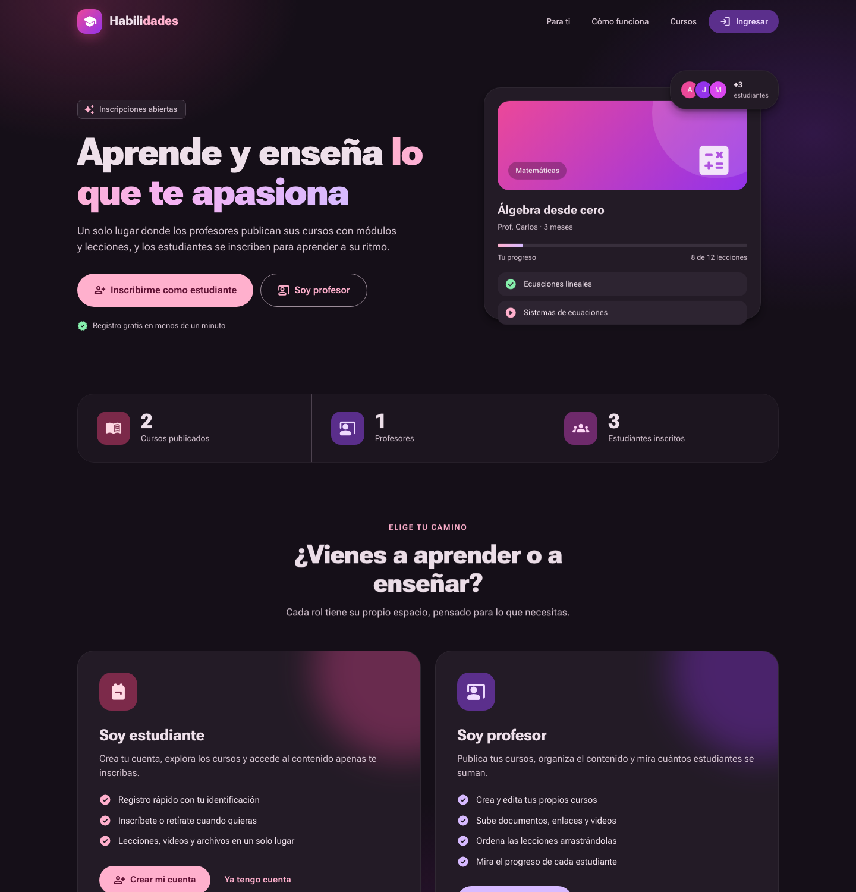
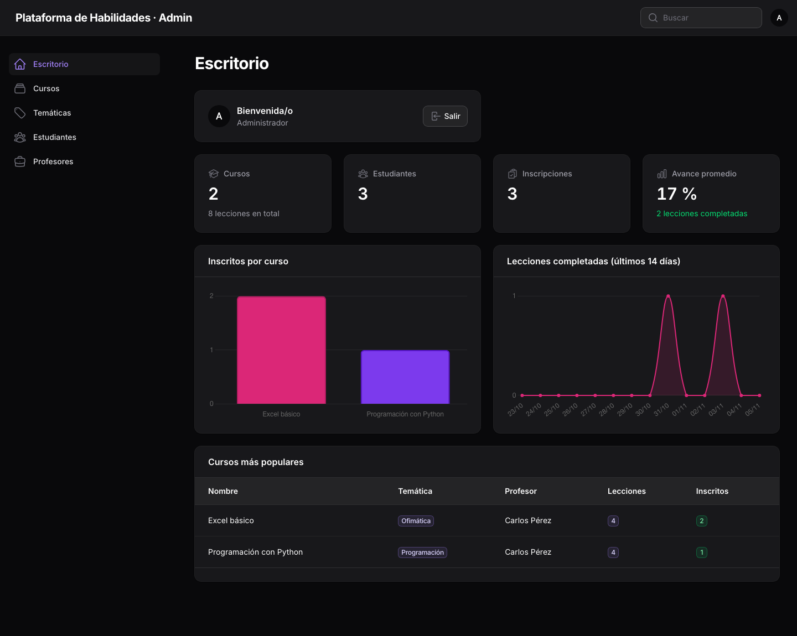
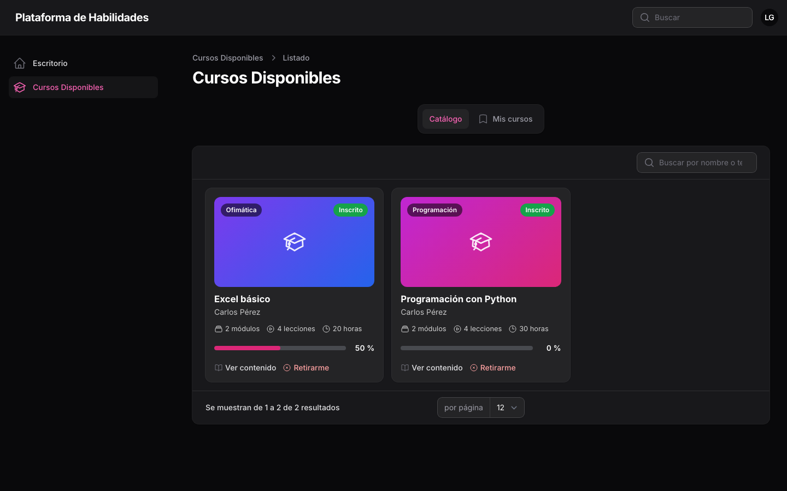
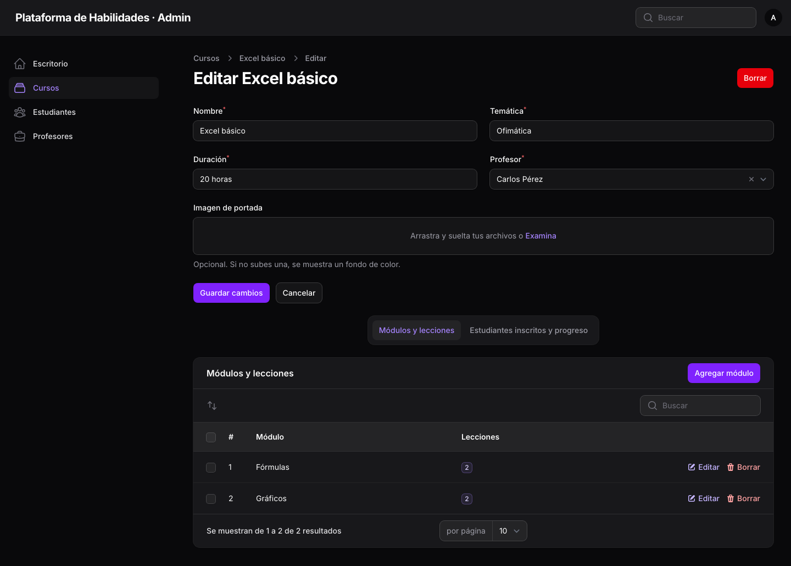
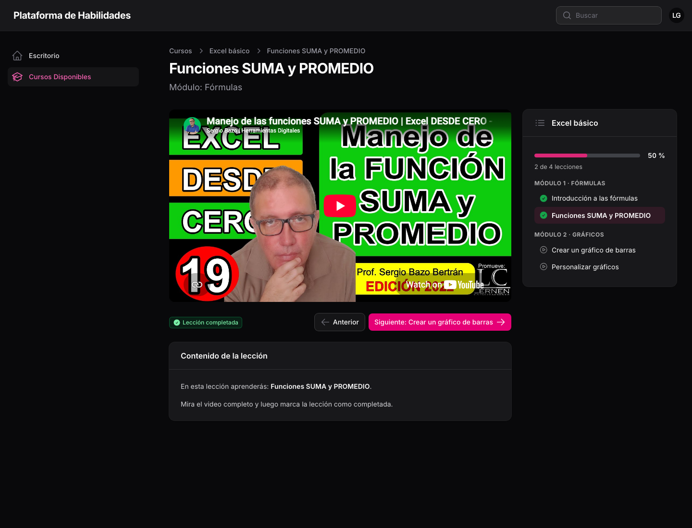
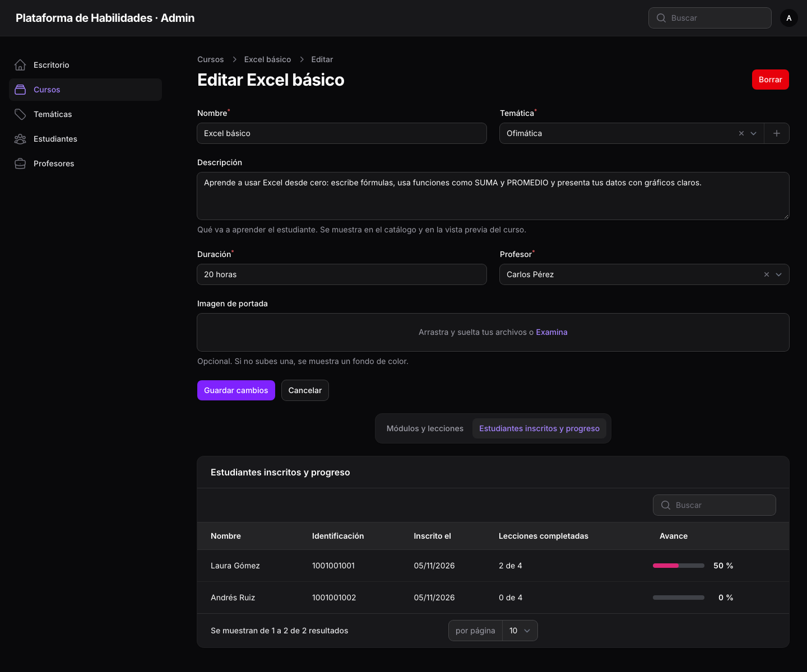
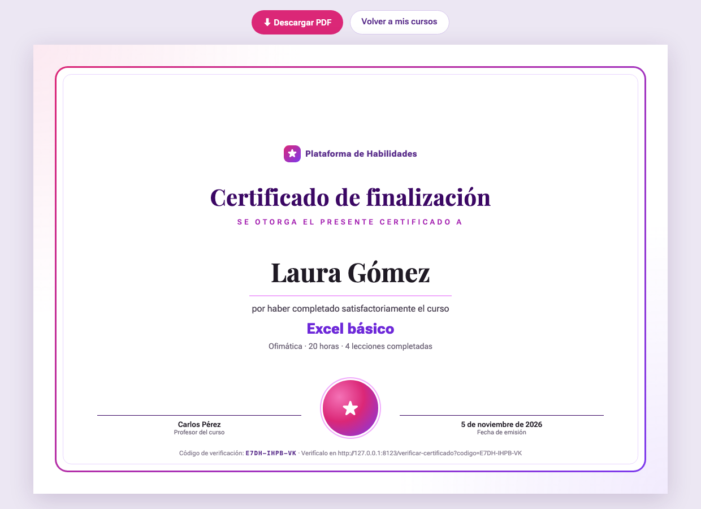

# Plataforma para aprender habilidades

Proyecto del **Grupo 2** – SENA, Técnico en Programación de Software (ficha 3171240).
Institución Educativa Benedikta Zur Nieden.

Aprendiz: **Ashlee Alejandra Ramírez Castro**

Plataforma web de cursos en línea. Un **administrador** crea cursos organizados en **módulos** y **lecciones con video**; los **estudiantes** se registran, se inscriben, desarrollan las lecciones, las marcan como completadas y consultan su **porcentaje de avance**. Al terminar un curso reciben un **certificado en PDF** con código de verificación.



---

## Contenido

1. [Funcionalidades](#funcionalidades)
2. [Tecnologías](#tecnologías)
3. [Requisitos](#requisitos)
4. [Instalación paso a paso](#instalación-paso-a-paso)
5. [Usuarios y datos de prueba](#usuarios-y-datos-de-prueba)
6. [Paneles por rol](#paneles-por-rol)
7. [Base de datos](#base-de-datos)
8. [Estructura del proyecto](#estructura-del-proyecto)
9. [Ajustes del plan de mejoramiento](#ajustes-del-plan-de-mejoramiento)
10. [Recorrido para la sustentación](#recorrido-para-la-sustentación)
11. [Evidencias](#evidencias)
12. [Solución de problemas](#solución-de-problemas)

---

## Funcionalidades

**Administrador**
- Escritorio con resumen (cursos, estudiantes, inscripciones, lecciones completadas), gráficas y actividad reciente.
- CRUD de **cursos**: nombre, descripción, temática, duración, profesor, portada y estado (borrador o publicado).
- Dentro de cada curso: **módulos** ordenables y sus **lecciones** (contenido con formato, video de YouTube, enlace `.mp4` o archivo subido y material de apoyo descargable).
- CRUD de **temáticas**, **estudiantes** y **profesores** (cada uno con su cuenta de acceso).
- Lista de estudiantes inscritos en cada curso con su porcentaje de avance.

**Profesor**
- Escritorio con estadísticas y gráficas **solo de sus cursos**.
- Gestiona sus propios cursos, módulos y lecciones, y puede publicarlos.
- Ve el progreso de sus estudiantes.

**Estudiante**
- Registro e inicio de sesión.
- **Catálogo** con búsqueda y filtro por temática; solo muestra cursos publicados.
- **Vista previa** del curso (descripción y temario) antes de inscribirse.
- **Inscripción** en un clic; la pestaña **Mis cursos** muestra sus cursos con barra de progreso.
- Página de lección: video, contenido, material de apoyo, temario lateral y botón **Marcar como completada** (con confeti 🎉).
- Botón **Continuar** que lleva a la siguiente lección pendiente.
- **Certificado en PDF** al completar el 100 % de un curso.

**Para todos**
- **Mi perfil**: cambiar nombre, correo y contraseña.
- Cada usuario solo entra al panel de su rol.
- Página pública `/verificar-certificado` para comprobar el código de un certificado.

## Tecnologías

| Tecnología | Uso |
|---|---|
| PHP 8.3+ con **Laravel 13** | Backend, rutas, modelos, migraciones y seeders |
| **Filament 5** (con Livewire) | Paneles de administrador, profesor y estudiante |
| **MySQL** 8 (o MariaDB) | Base de datos relacional |
| Blade + CSS | Página de inicio, lecciones, certificado y verificación |

No hace falta Node.js ni npm: los estilos de Filament ya vienen compilados.

## Requisitos

- **PHP 8.3** o superior con las extensiones `pdo_mysql`, `mbstring`, `fileinfo`, `intl` y `zip`.
- **[Composer](https://getcomposer.org/)** 2.
- **MySQL** 8 (o MariaDB 10.6+) en ejecución.
- **Git** para clonar el repositorio.

> En Windows lo más sencillo es instalar [Laragon](https://laragon.org/) o XAMPP, que ya traen PHP y MySQL.

Para comprobar las versiones:

```bash
php -v
composer -V
mysql --version
```

## Instalación paso a paso

### 1. Clonar el repositorio

```bash
git clone https://github.com/dolyscastro1028-collab/habilidades.git
cd habilidades
```

### 2. Instalar las dependencias de PHP

```bash
composer install
```

### 3. Crear el archivo de configuración

```bash
cp .env.example .env
php artisan key:generate
```

En Windows (CMD) se usa `copy .env.example .env` en lugar de `cp`.

### 4. Crear la base de datos vacía

Desde la consola de MySQL, phpMyAdmin o MySQL Workbench:

```sql
CREATE DATABASE habilidades CHARACTER SET utf8mb4 COLLATE utf8mb4_unicode_ci;
```

### 5. Configurar la conexión en `.env`

Abrir el archivo `.env` y poner el usuario y la contraseña de MySQL:

```env
DB_CONNECTION=mysql
DB_HOST=127.0.0.1
DB_PORT=3306
DB_DATABASE=habilidades
DB_USERNAME=root
DB_PASSWORD=tu_contraseña
```

### 6. Crear las tablas y cargar los datos de prueba

```bash
php artisan migrate --seed
```

> **Alternativa:** en lugar del comando anterior se puede importar el script SQL incluido, que trae la estructura y los mismos datos:
> ```bash
> mysql -u root -p habilidades < database/habilidades.sql
> ```

### 7. Enlazar la carpeta de archivos subidos

Necesario para ver portadas, videos subidos y material de apoyo:

```bash
php artisan storage:link
```

### 8. Iniciar el servidor

```bash
php artisan serve
```

Abrir **<http://127.0.0.1:8000>** en el navegador.

### Volver a dejar la base como al inicio

Borra todas las tablas y vuelve a cargar los datos de prueba:

```bash
php artisan migrate:fresh --seed
```

## Usuarios y datos de prueba

La contraseña de todos es **`password`**.

| Rol | Correo | Panel | Datos |
|---|---|---|---|
| Administrador | `admin@plataforma.com` | `/admin` | |
| Profesor | `profesor@plataforma.com` | `/profesor` | Carlos Pérez, profesor de los cursos de prueba |
| Estudiante | `laura@plataforma.com` | `/estudiante` | Inscrita en Excel y Python; 2 de 4 lecciones de Excel completadas (50 %) |
| Estudiante | `andres@plataforma.com` | `/estudiante` | Inscrito en Excel básico, sin avance |
| Estudiante | `sofia@plataforma.com` | `/estudiante` | Sin inscripciones (sirve para probar la inscripción) |

**Temáticas:** Ofimática, Programación, Diseño gráfico e Idiomas.

**Cursos:**

| Curso | Temática | Estado | Contenido |
|---|---|---|---|
| Excel básico | Ofimática | Publicado | Módulos *Fórmulas* y *Gráficos*, 4 lecciones con video. La primera trae una guía en PDF como material de apoyo. |
| Programación con Python | Programación | Publicado | Módulos *Fundamentos* y *Estructuras de control*, 4 lecciones con video |
| Diseño con Canva | Diseño gráfico | Borrador | Un módulo, sin lecciones (no aparece en el catálogo) |

Los videos son tutoriales públicos de YouTube y se reproducen dentro de la plataforma.

## Paneles por rol

| Rol | Dirección | Qué puede hacer |
|---|---|---|
| Administrador | `/admin` | Ver el resumen y las gráficas de la plataforma. Crear, consultar, editar y eliminar cursos, módulos, lecciones, temáticas, profesores y estudiantes. Publicar cursos. Ver el progreso de los inscritos. |
| Profesor | `/profesor` | Ver el resumen y las gráficas de sus cursos. Gestionar sus propios cursos, módulos y lecciones y ver el progreso de sus estudiantes. Su cuenta la crea el administrador. |
| Estudiante | `/estudiante` | Registrarse, ver el catálogo, inscribirse, desarrollar las lecciones, marcarlas como completadas, ver su progreso y descargar sus certificados. |

### Reglas importantes

- Los cursos nuevos quedan en **borrador**. Los estudiantes no los ven hasta que el administrador o el profesor los **publican**, y solo se pueden publicar si tienen al menos una lección.
- Si un curso vuelve a borrador, los estudiantes ya inscritos conservan su acceso.
- Un estudiante no se puede inscribir dos veces en el mismo curso ni completar dos veces la misma lección (lo garantiza la base de datos con claves únicas).
- Solo los inscritos pueden abrir las lecciones de un curso.
- No se puede eliminar una temática que tenga cursos.
- Al eliminar un estudiante o un profesor también se elimina su cuenta de usuario.
- El certificado solo se genera cuando el estudiante completa el 100 % del curso. Cada uno tiene un código único (formato `XXXX-XXXX-XX`).

### Capturas

| Administrador | Estudiante |
|---|---|
|  |  |
|  |  |
|  |  |

Todas las capturas están en [`docs/capturas/`](docs/capturas).

## Base de datos

Base de datos relacional normalizada (3FN) con 11 tablas propias:

| Tabla | Descripción | Relaciones |
|---|---|---|
| `roles` | admin, profesor, estudiante | |
| `users` | Cuenta de acceso: nombre, correo y contraseña | `role_id` → `roles` |
| `profesores` | Identificación, edad y materia | `user_id` → `users` (único) |
| `estudiantes` | Identificación y edad | `user_id` → `users` (único) |
| `tematicas` | Ofimática, Programación, Diseño gráfico, Idiomas… | |
| `cursos` | Nombre, descripción, duración, portada y estado (publicado o borrador) | `profesor_id` → `profesores`, `tematica_id` → `tematicas` |
| `modulos` | Módulos de un curso, en orden | `curso_id` → `cursos` |
| `lecciones` | Contenido, video (enlace o archivo) y material de apoyo, en orden | `modulo_id` → `modulos` |
| `clases` | Inscripciones (estudiante ↔ curso) | `estudiante_id`, `curso_id` (únicos juntos) |
| `progreso` | Lecciones completadas por cada estudiante | `estudiante_id`, `leccion_id` (únicos juntos) |
| `certificados` | Certificado de un curso terminado, con código de verificación | `estudiante_id`, `curso_id` (únicos juntos) |

Además están las tablas internas de Laravel (`sessions`, `cache`, `jobs`, `password_reset_tokens`, `migrations`).

```
roles ─< users ─┬─ profesores ─< cursos >─ tematicas
                └─ estudiantes      │
                     │  │  │        └─< modulos ─< lecciones
                     │  │  └──< clases >──── cursos
                     │  └─────< progreso >── lecciones
                     └────────< certificados >─ cursos
```

**Normalización**

- El nombre y el correo se guardan **una sola vez** en `users`; `estudiantes` y `profesores` los toman de ahí por su `user_id`.
- La temática se guarda una sola vez en `tematicas` y los cursos la referencian por `tematica_id`.
- Las relaciones muchos a muchos (inscripciones, progreso y certificados) tienen su propia tabla intermedia.

**Cálculo del progreso**

```
porcentaje = lecciones completadas del curso ÷ total de lecciones del curso × 100
```

**Archivos relacionados**

- Migraciones: [`database/migrations/`](database/migrations)
- Datos de prueba: [`database/seeders/DatabaseSeeder.php`](database/seeders/DatabaseSeeder.php)
- Script SQL completo: [`database/habilidades.sql`](database/habilidades.sql)

## Estructura del proyecto

```
app/
├── Filament/
│   ├── Resources/        Panel administrador: Cursos, Temáticas, Estudiantes, Profesores
│   ├── Profesor/         Panel profesor: sus cursos
│   ├── Estudiante/       Panel estudiante: catálogo, curso, lecciones y widgets
│   ├── Widgets/          Gráficas y estadísticas (admin y profesor)
│   └── Auth/             Registro de estudiantes
├── Http/Controllers/
│   └── CertificadoController.php   Certificado PDF y verificación
├── Models/               Role, User, Estudiante, Profesor, Tematica, Curso,
│                         Modulo, Leccion, Certificado
└── Providers/Filament/   Configuración de los 3 paneles
database/
├── migrations/           Estructura de las tablas
├── seeders/              Datos de prueba (y el PDF de material de apoyo)
└── habilidades.sql       Script SQL de la base de datos
resources/views/
├── welcome.blade.php     Página de inicio
├── certificados/         Certificado y página de verificación
└── filament/             Vistas personalizadas (lección, temario, tarjetas, progreso)
routes/web.php            Inicio, certificado y verificación
docs/                     Evidencias del plan de mejoramiento
```

## Ajustes del plan de mejoramiento

| # | Ajuste solicitado | Dónde se cumple |
|---|---|---|
| 1 | CRUD de cursos con módulos, lecciones y video | `/admin` → Cursos → Módulos y lecciones |
| 2 | Registro e inicio de sesión con roles | `/estudiante/register` y login en `/admin`, `/profesor` y `/estudiante` |
| 3 | Inscripción a cursos | `/estudiante` → Catálogo → Inscribirme (tabla `clases`) |
| 4 | Lecciones con opción de completar | Página de la lección → Marcar como completada (tabla `progreso`) |
| 5 | Porcentaje de progreso | Mis cursos, escritorio del estudiante y lista de inscritos del admin |
| 6 | Base de datos relacional normalizada con script SQL | `database/migrations` y `database/habilidades.sql` |
| 7 | Mapa de navegación y tabla de pruebas | `docs/Evidencias_Plan_Mejoramiento_Grupo2.pdf` |

## Recorrido para la sustentación

1. **Administrador:** entrar a `/admin` con `admin@plataforma.com` → **Cursos → Crear**. Llenar los datos y guardar.
2. En **Módulos y lecciones**, agregar un módulo con una lección (contenido y enlace de YouTube). Activar **Publicado**.
3. **Estudiante:** abrir `/estudiante` → **Registrarse** con un correo nuevo.
4. En **Catálogo**, abrir el curso creado (vista previa) y pulsar **Inscribirme**. Aparece en **Mis cursos**.
5. Abrir la lección, reproducir el video y pulsar **Marcar como completada**.
6. Ver el avance en **Mis cursos** (estudiante) y en **Estudiantes inscritos y progreso** (admin, al editar el curso).
7. Al llegar al 100 %, descargar el **certificado** y comprobar su código en `/verificar-certificado`.
8. **Profesor:** entrar a `/profesor` con `profesor@plataforma.com` y mostrar que solo ve sus cursos.
9. **MySQL:** revisar las tablas `users`, `estudiantes`, `cursos`, `modulos`, `lecciones`, `clases`, `progreso` y `certificados`.

## Evidencias

Dentro de la aplicación, el **administrador** las abre desde el menú lateral de `/admin`: **Evidencias** (página web) y **Evidencias (PDF)**. También se pueden abrir en `/evidencias` estando con la sesión del administrador.

Los archivos están en la carpeta [`docs/`](docs):

- [`Evidencias_Plan_Mejoramiento_Grupo2.pdf`](docs/Evidencias_Plan_Mejoramiento_Grupo2.pdf): diagrama relacional, normalización, mapa de navegación por rol, tabla de 46 pruebas y capturas de pantalla.
- [`evidencias.html`](docs/evidencias.html): el mismo documento en HTML (se abre en el navegador).
- [`capturas/`](docs/capturas): capturas de pantalla de cada panel.
- [`database/habilidades.sql`](database/habilidades.sql): script SQL con la estructura y los datos de prueba.

## Solución de problemas

| Problema | Solución |
|---|---|
| `Table 'habilidades.roles' doesn't exist` u otra tabla o columna que no existe | La base se creó con una versión anterior del proyecto. Ejecutar `php artisan migrate:fresh --seed` (borra los datos y crea todo de nuevo). |
| `could not find driver` | Activar la extensión `pdo_mysql` en `php.ini`. |
| `Access denied for user 'root'` | Revisar `DB_USERNAME` y `DB_PASSWORD` en `.env`. |
| `Unknown database 'habilidades'` | Crear la base de datos (paso 4). |
| `No application encryption key has been specified` | Ejecutar `php artisan key:generate`. |
| No se ven las portadas, videos subidos o material | Ejecutar `php artisan storage:link`. |
| Se cambió `.env` y no toma los cambios | Ejecutar `php artisan optimize:clear`. |
| Los videos de YouTube o el confeti no aparecen | Necesitan conexión a internet. |
| Error al subir un video grande | El límite es 12 MB; para videos más grandes usar un enlace de YouTube. |
